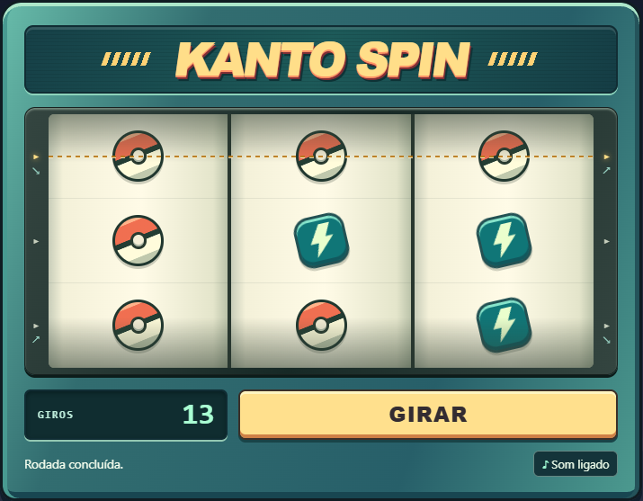

# PokéSlot

Um arcade de coleção idealizado e dirigido por **Caetano Coimbra**. Cada rodada dura alguns instantes. A estratégia aparece entre os giros, ao escolher qual espécie resgatar ou qual Pokémon evoluir para completar a Pokédex de Kanto.

**[Abrir a máquina](https://pokeslot.pages.dev/) · [Case do projeto](https://pokeslot.pages.dev/case/) · [English case study](https://pokeslot.pages.dev/case/en/)**

Crie uma conta para jogar na máquina hospedada e recuperar seu progresso. Use um e-mail ao qual tenha acesso para receber o link de redefinição de senha. O repositório também inclui um modo de desenvolvimento local.



## Como jogar

1. **Gire.** A conta começa com 20 giros. Cada rodada custa um. Cada rolo embaralha suas 20 posições e para em uma delas. A máquina verifica três horizontais e duas diagonais. Cada linha com três símbolos iguais concede sua própria recompensa.
2. **Colecione.** Três Pokébolas concedem uma captura. O sorteio escolhe a raridade (70% comum, 22% incomum, 7% raro, 1% lendário) e uma espécie desse grupo. A chance de shiny é de 0,5% por captura, independente da raridade. Uma espécie aparece na Pokédex assim que qualquer uma das variantes é registrada.
3. **Escolha o próximo registro.** Uma linha de vales sorteia, com chances iguais, um vale Pokémon, um vale pedra ou um vale de dois giros. O vale Pokémon permite escolher uma variante normal faltante por 1 a 4 vales, conforme a raridade. Ao evoluir com uma pedra compatível, o destino herda a variante e a origem continua disponível.

Uma linha de símbolos de giro concede dois giros. Capturar de novo a **mesma variante** compensa o jogador com 1, 1, 2 ou 3 giros por raridade. A compensação dobra para um shiny repetido. O saldo recebe mais 10 giros por período completo de 24 horas desde o primeiro acesso. Após 53 horas, são duas reposições e cinco horas já transcorridas para a terceira.

## Da regra ao banco

| Camada | Responsabilidade |
| --- | --- |
| Interface PT/EN em JavaScript e CSS, servida pelo Cloudflare Pages | Receber comandos, animar os rolos e apresentar o resultado confirmado. A Pokédex usa folhas de sprites locais para preservar as silhuetas e os registros quando a PokéAPI está indisponível. |
| Neon Auth e Neon Function | Identificar a conta, exigir uma sessão ativa e sortear o resultado no servidor. |
| PostgreSQL | Aplicar débito, recompensas e registros da coleção na mesma transação. A operação tem um identificador que permite recuperar a primeira resposta após uma interrupção. |
| PokéAPI | Fornecer dados das espécies para as fichas. Nomes e sprites de referência incluídos no projeto também vêm dos repositórios da PokéAPI. |

## Decisões e resultados de Caetano

Caetano definiu as regras, a arquitetura, o orçamento de R$ 0 e os critérios de aceite. Conduziu o projeto da prova de saldo até a publicação da máquina. Usou IA para pesquisar alternativas, escrever e revisar código e automatizar verificações. Participou diretamente das provas de troca de conta, recuperação de senha e acessibilidade.

| Decisão | Como foi avaliada |
| --- | --- |
| Separar a apresentação do estado do jogador | Com contas fictícias no mesmo navegador, a coleção de uma conta foi preservada ao entrar em outra. Em um teste com estoque preparado, Pikachu e Raichu continuaram registrados após recarregar. |
| Dar ao jogador escolhas para completar Kanto | O simulador comparou 1.500 trajetórias por cenário. Com três vales equiprováveis, 72 receitas e até 25 rodadas por dia, a mediana simulada para 151 espécies foi de 61 dias. |
| Tornar o resultado acessível pelo teclado e por áudio assistivo | No endereço definitivo, uma rodada pelo teclado levou o saldo de 25 para 24. O valor persistiu após recarregar. Caetano confirmou a narração com o Narrador do Windows. |

O [roteiro e as evidências de validação](docs/roteiro-1.0.md) documentam os ambientes de cada prova. Os [cenários de progressão](docs/vales-evolucao-integracao.md) detalham as hipóteses da simulação.

## Executar e verificar

O projeto foi verificado com Node.js 26.13.1 e pnpm 11.25.0. O modo local usa o SQLite incluído no Node e funciona sem conta Neon.

```sh
pnpm install --frozen-lockfile
pnpm dev
```

Abra o endereço indicado pelo Vite. O servidor de desenvolvimento guarda um único jogador no arquivo ignorado `.pokeslot-demo.sqlite`. Esse modo usa sorteio simplificado, cinco tipos de vale e 16 receitas clássicas. A economia completa de giros, compensações, três vales e 72 evoluções funciona na máquina **hospedada**.

```sh
pnpm test
pnpm build
```

O build do site usa `pnpm build:site` com os dois endereços públicos `VITE_NEON_PROOF_*` de [.env.example](.env.example) configurados em `.env.local` ou no ambiente. O destino é `dist/homologacao`. As credenciais do banco pertencem exclusivamente ao runtime da Function. A suíte local e a [verificação HTTP da publicação](scripts/verify-public-security.mjs) cobrem camadas diferentes.

## Encontrar o código

- [Regras de domínio](src/domain) e [sorteios no servidor](src/server)
- [Máquina, Pokédex e inventário](src/preview) e [cliente da PokéAPI](src/pokeapi)
- [Function autenticada](functions/neon-game-proof/index.ts) e [transações PostgreSQL](db/neon)
- [Testes](test) e [simulador de progressão](scripts/simular-progressao-v1.mjs)

Projeto pessoal e não comercial de fã. Pokémon e os personagens pertencem aos respectivos titulares. Dados e sprites utilizados no catálogo estão disponíveis na [PokéAPI](https://pokeapi.co/) e no [repositório de sprites](https://github.com/PokeAPI/sprites).
