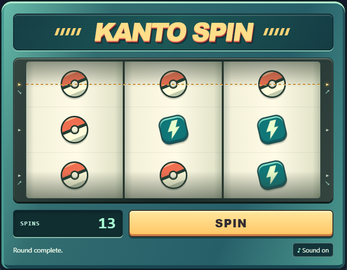

# PokéSlot

**English · [Português (Brasil)](README.pt-BR.md)**

PokéSlot is a bilingual arcade game where players spin three reels and collect all 151 Pokémon from Kanto. Each account has its own balance, Pokédex and inventory. The server determines rewards and PostgreSQL saves the results.

**[Play the game](https://pokeslot.pages.dev/?lang=en) · [English case study](https://pokeslot.pages.dev/case/en/) · [Estudo de caso em português](https://pokeslot.pages.dev/case/)**

Create an account to play and recover your progress. Use an email address you can access to receive a password reset link. Visitors who try to spin before signing in meet Professor Coimbra in an introduction that does not create a round or change player data.



## Highlights

- **Collect Kanto:** discover 151 species, with search, filters, silhouettes and normal/shiny variants. Shiny is optional for completing the collection.
- **Spin and earn rewards:** three horizontal and two diagonal paylines can award Pokémon, extra spins or vouchers. Each winning line awards a prize.
- **Make choices:** redeem Pokémon vouchers for missing normal variants and choose stones for compatible evolutions. Evolution preserves the original Pokémon and its variant.
- **Resume safely:** the database applies changes transactionally. A pending operation can be recovered using its existing ID after an interrupted response, within the supported recovery period.
- **Play in Portuguese or English:** the interface supports keyboard use, reduced motion, optional sound, reward effects and Pokédex cries.

## Game rules

Each reel has 20 positions: 10 Poké Balls, six spin symbols and four vouchers. Reels are shuffled on each round and stop at randomly selected positions. An account starts with **20 spins**; each round costs one. Every complete 24-hour period adds **10 spins**. Periods accumulate while the player is away, and the cycle does not restart when the game is opened.

A Poké Ball payline selects a rarity (70% common, 22% uncommon, 7% rare, 1% legendary), then a species within that tier. The shiny chance is independently **0.5% per catch**. A duplicate of the same variant awards 1, 1, 2 or 3 spins by rarity; this compensation doubles for a shiny duplicate. A spin-symbol payline awards two spins.

A voucher payline awards, with equal probability, a Pokémon voucher, a stone voucher or two spins. A Pokémon voucher redeems a missing normal variant for one to four vouchers according to rarity. A stone voucher lets the player choose a stone for a compatible evolution.

## How it works

| Layer | Responsibility |
| --- | --- |
| HTML, CSS and modular JavaScript on Cloudflare Pages | Present the game, animate the confirmed result and provide the bilingual interface. IndexedDB stores pending operation intent in the browser. |
| Neon Auth and a Neon Function using TypeScript and Hono | Authenticate the player, validate the session and determine round outcomes on the server. |
| PostgreSQL | Apply debits, replenishment, rewards and collection updates transactionally. Operation IDs support recovery from interrupted responses. |
| PokéAPI and local assets | Provide Pokémon data and cries. Local sprites and a versioned description catalog preserve useful Pokédex content when live data is unavailable. |

Portuguese descriptions are project translations assisted by AI, with English sources recorded in the [catalog documentation](src/pokeapi/README.md); they are not presented as official translations. The game does not call an AI translation service during play.

## Product decisions and evidence

**Caetano Coimbra** conceived and led the project, setting the game rules, architecture, zero-cost constraint and acceptance criteria. He used AI to support research, implementation, code review and automated checks, and took part in manual tests of account switching, password recovery and accessibility.

| Decision | Evidence |
| --- | --- |
| Keep each player's state separate | In a test with prepared inventory, player C redeemed Pikachu, evolved it into Raichu and recovered both after reloading. Player B saw B's own inventory. |
| Give players choices when completing Kanto | A model compared 1,500 simulated trajectories per scenario. With three equally likely vouchers, 72 evolutions and up to 25 rounds a day, the simulated median was 61 days. This is not observed player behavior. |
| Support keyboard and assistive technology | On the hosted game, a keyboard spin reduced the balance from 25 to 24 and the result persisted after reload. Caetano confirmed announcements with Windows Narrator. |

The [validation roadmap](docs/roteiro-1.0.md) and [progression scenarios](docs/vales-evolucao-integracao.md) provide additional context in Portuguese. The [English case study](https://pokeslot.pages.dev/case/en/) summarizes the project and its trade-offs.

## Run locally

The project has been verified with **Node.js 26.13.1** and **pnpm 11.25.0**. The local development mode uses Node's built-in SQLite and does not require a Neon account.

```sh
pnpm install --frozen-lockfile
pnpm dev
```

Open the URL printed by Vite. The local server stores one demo player in the ignored `.pokeslot-demo.sqlite` file. Its rules are simplified: it uses five voucher types and 16 classic evolutions. The hosted game uses the full economy, three voucher types and 72 evolutions.

Run the unit and integration suite and create a local build:

```sh
pnpm test
pnpm build
```

The browser checks in [verify-preview-browser.mjs](scripts/verify-preview-browser.mjs) use Playwright and axe-core installed separately. They are not included in `pnpm test`, and this repository does not currently have a CI pipeline.

For the hosted-site build, configure the two public `VITE_NEON_PROOF_*` URLs shown in [.env.example](.env.example) in `.env.local` or the environment, then run `pnpm build:site`. The output goes to `dist/homologacao`. Database credentials belong only in the Function runtime; never put them in frontend configuration. The local suite and [public HTTP checks](scripts/verify-public-security.mjs) cover different layers.

## Project layout

- [Domain rules](src/domain) and [server-side draws](src/server)
- [Game interface and inventory](src/preview) and [PokéAPI client](src/pokeapi)
- [Authenticated Function](functions/neon-game-proof/index.ts) and [PostgreSQL transactions](db/neon)
- [Tests](test) and [progression simulator](scripts/simular-progressao-v1.mjs)
- [Professor Coimbra artwork and its creation](docs/arte-professor-coimbra.md)

## Scope and credits

PokéSlot is a personal, non-commercial fan project. Pokémon and its characters belong to their respective rights holders. Pokémon data and sprites are available from [PokéAPI](https://pokeapi.co/) and its [sprites repository](https://github.com/PokeAPI/sprites). The hosted demo depends on third-party free services and their availability and limits; password recovery uses Neon's shared sender. The repository does not currently include an open-source license.
